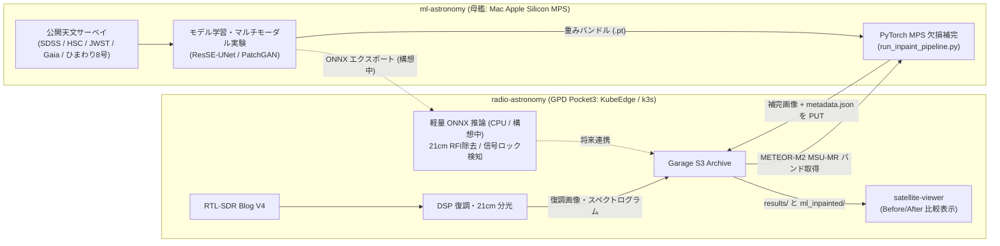
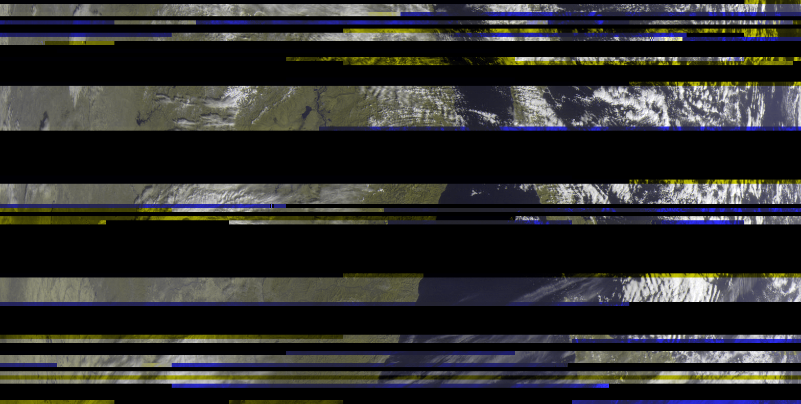
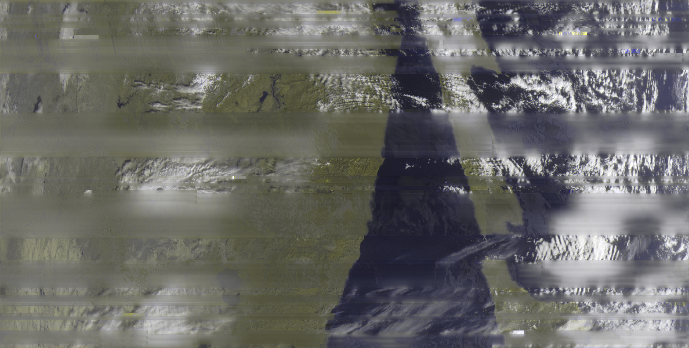

# ml-astronomy

[](https://www.python.org/)
[](https://pytorch.org/)
[](https://www.astropy.org/)
[](https://onnxruntime.ai/)
[](https://jupyter.org/)

公開天文ビッグデータ（SDSS / HSC / JWST / Gaia）を使ったマルチモーダル深層学習の実験から、個人用衛星地上局・銀河21cm電波望遠鏡リポジトリ（[`tozastation/radio-astronomy`](https://github.com/tozastation/radio-astronomy)）と連携する Edge / Cloud ハイブリッド推論基盤までを扱う、天文学×機械学習のリポジトリです（旧 `try-astronomy` から改名・再編）。

## `radio-astronomy` との連携

本リポジトリは実観測を行う観測所（[`radio-astronomy`](https://github.com/tozastation/radio-astronomy)）と対になる解析・機械学習ラボ（`ml-astronomy`）として位置づけています。モデルの計算量やリアルタイム性の要件に応じて、Cloud / 母艦（Apple Silicon MPS）でのバッチ推論と Edge（CPU / KubeEdge）での軽量推論に役割を分けています。



## プロジェクト構成 (`projects/`)

### 1. [`projects/multimodal-universe/`](projects/multimodal-universe/README.md)

Hugging Face 等で公開されている天文大規模データセット（[MultimodalUniverse](https://github.com/MultimodalUniverse/MultimodalUniverse)）を用いたプロジェクト群です。

* `galaxy-classifier/`（活動銀河核 AGN ハンター）: すばる望遠鏡 HSC（5バンド画像）× SDSS（スペクトル）の天球クロスマッチングによる AGN 2クラス分類（関連ブログ: [Qiita](https://qiita.com/tozastation/items/09e118bf67e129813d00)、進行中の改善項目: [GitHub Issue #8](https://github.com/tozastation/ml-astronomy/issues/8)）
* `galaxy10_decals/`: DECaLS 銀河画像（10クラス）の形態分類 CNN 実験
* `gaia/`: Gaia 衛星データの検証と 3D 星図の可視化

### 2. [`projects/ceers-photo-z/`](projects/ceers-photo-z/README.md)

ジェイムズ・ウェッブ宇宙望遠鏡（JWST）の CEERS サーベイデータ（HDF5）を用いたデータ可視化、PyTorch（Apple Silicon MPS / Ray Tune）による学習実験、および Flask による簡易推論 API のプロトタイプです（旧 `auto_area_estimation/`）。

### 3. [`projects/radio-ml/`](projects/radio-ml/README.md)

ベランダ電波観測所（[`tozastation/radio-astronomy`](https://github.com/tozastation/radio-astronomy)）で受信・アーカイブされた観測データ向けの機械学習パイプラインです。METEOR-M2 気象衛星画像の欠損補完パイプラインが稼働中で、Edge 推論についても構想・検討を進めています（[GitHub Issue #7](https://github.com/tozastation/ml-astronomy/issues/7)）。

* **Cloud / 母艦推論（Mac Apple Silicon MPS・稼働中）**:
  * 11 本の実験ノートブック（`01`〜`11`）で構築した 2 種類の PyTorch モデル：`CoastlineGuidedSharpResSEUNet`（8ch 単体補完・視野外/夜間赤外対応）と `PrevImageGuidedResSEUNet`（11ch 前イメージ＋ひまわり8号較正地表アトラス＋Leave-One-Out 過去パス逆投影による低受信率パス補完）
  * 手動実行 CLI（`projects/radio-ml/scripts/run_inpaint_pipeline.py`）で Garage S3 上の未補完パスを差分検出し、`ml_inpainted/` 配下へ 4 種の PNG（AVHRR 221・MSU-MR 124・補完前 Raw・マスクオーバーレイ）と `metadata.json` を転送
  * 学習済み重み（`.pt` 2 ファイル）は GitHub Release [`radio-ml-models-v1`](https://github.com/tozastation/ml-astronomy/releases/tag/radio-ml-models-v1) で配布
* **Edge 推論（KubeEdge CPU / ONNX・構想中）**: 銀河 21cm 水素線（1420.406 MHz）スペクトルの RFI（人工電波混信）自動検知とウォーターフォールからのキャリア信号検知を予定

| 補完前（Raw AVHRR 221 / `2026-10-26` パス） | 補完後（11ch `PrevImageGuidedResSEUNet`） |
| :---: | :---: |
|  |  |

## 基礎学習・シミュレーション (`fundamentals/`)

天文学・宇宙物理学の基礎理論をコードと可視化で追体験するための教材・実験コード群です。

* `fundamentals/extreme_unraveling-the-universe/`: 書籍『極・宇宙を解く』（恒星社厚生閣）に沿った Jupyter ノートブック演習
* `fundamentals/playground/`: ケプラーの法則、宇宙膨張とスペクトル赤方偏移、シュワルツシルト半径、衛星軌道投入（LEO → GTO → GEO）などのシミュレーションスクリプト

## ディレクトリ構成

```text
ml-astronomy/
├── README.md
├── pyproject.toml                       # プロジェクト共通の依存関係 (uv 管理)
├── uv.lock
├── projects/                            # 機械学習・データ解析プロジェクト
│   ├── multimodal-universe/             # MultimodalUniverse (AGN分類 / Galaxy10 / Gaia)
│   ├── ceers-photo-z/                   # JWST CEERS 解析・PyTorch学習・推論API
│   └── radio-ml/                        # METEOR-M2 画像欠損補完 (MPS推論・Garage S3転送 / Edge ONNX構想)
├── fundamentals/                        # 基礎理論・教育コンテンツ・物理シミュレーション
│   ├── extreme_unraveling-the-universe/ # 『極・宇宙を解く』Jupyter演習
│   └── playground/                      # 軌道力学・天体物理シミュレーションスクリプト
└── scripts/                             # ユーティリティスクリプト (Jupyterライブ実行 run_notebook_live.py / PDF変換 等)
```

## セットアップ (macOS ネイティブ)

macOS（Apple Silicon MPS 対応）ネイティブ環境での開発を前提としています。ツールと依存関係の管理には `mise` と [`uv`](https://docs.astral.sh/uv/) を使用しています（Python 3.11 以上）。

```bash
# リポジトリのクローン
git clone https://github.com/tozastation/ml-astronomy.git
cd ml-astronomy

# Python / uv のセットアップ (mise を利用する場合)
mise install

# 依存ライブラリのインストール
uv sync

# JupyterLab の起動
uv run --with jupyterlab jupyter lab
```

METEOR-M2 画像の欠損補完パイプラインを実行する場合は、GitHub Release から学習済みモデル（`.pt`）を取得してから CLI を実行します。

```bash
# 学習済みモデル (.pt) の取得
gh release download radio-ml-models-v1 --repo tozastation/ml-astronomy -D projects/radio-ml/models

# Garage S3 上の未補完パスを推論・転送
uv run python projects/radio-ml/scripts/run_inpaint_pipeline.py
```

`MultimodalUniverse` のデータセット読み込みスクリプト (`trust_remote_code=True`) は `datasets==2.21.0` で動作確認されているため、`pyproject.toml` でバージョンを固定しています。
