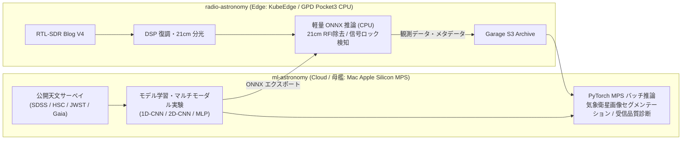

# ml-astronomy

[](https://www.python.org/)
[](https://pytorch.org/)
[](https://www.astropy.org/)
[](https://onnxruntime.ai/)
[](https://jupyter.org/)

公開天文ビッグデータ（SDSS / HSC / JWST / Gaia）を使ったマルチモーダル深層学習の実験から、個人用衛星地上局・銀河21cm電波望遠鏡リポジトリ（[`tozastation/radio-astronomy`](https://github.com/tozastation/radio-astronomy)）と連携する Edge / Cloud ハイブリッド推論基盤までを扱う、天文学×機械学習のリポジトリです（旧 `try-astronomy` から改名・再編）。

## `radio-astronomy` との連携構想

本リポジトリは実観測を行う観測所（[`radio-astronomy`](https://github.com/tozastation/radio-astronomy)）と対になる解析・機械学習ラボ（`ml-astronomy`）として位置づけています。モデルの計算量やリアルタイム性の要件に応じて、Edge（CPU / KubeEdge）と Cloud / 母艦（Apple Silicon MPS）に推論を振り分けるアーキテクチャを目指しています。



## プロジェクト構成 (`projects/`)

### 1. [`projects/multimodal-universe/`](projects/multimodal-universe/README.md)

Hugging Face 等で公開されている天文大規模データセット（[MultimodalUniverse](https://github.com/MultimodalUniverse/MultimodalUniverse)）を用いたプロジェクト群です。

* `galaxy-classifier/`（活動銀河核 AGN ハンター）: すばる望遠鏡 HSC（5バンド画像）× SDSS（スペクトル）の天球クロスマッチングによる AGN 2クラス分類（関連ブログ: [Qiita](https://qiita.com/tozastation/items/09e118bf67e129813d00)、進行中の改善項目: [GitHub Issue #8](https://github.com/tozastation/ml-astronomy/issues/8)）
* `galaxy10_decals/`: DECaLS 銀河画像（10クラス）の形態分類 CNN 実験
* `gaia/`: Gaia 衛星データの検証と 3D 星図の可視化

### 2. [`projects/ceers-photo-z/`](projects/ceers-photo-z/README.md)

ジェイムズ・ウェッブ宇宙望遠鏡（JWST）の CEERS サーベイデータ（HDF5）を用いたデータ可視化、PyTorch（Apple Silicon MPS / Ray Tune）による学習実験、および Flask による簡易推論 API のプロトタイプです（旧 `auto_area_estimation/`）。

### 3. [`projects/radio-ml/`](projects/radio-ml/README.md) (WIP / 構想中)

ベランダ電波観測所（[`tozastation/radio-astronomy`](https://github.com/tozastation/radio-astronomy)）の観測データに向けて今後構築を予定している機械学習パイプラインです（現在未実装・設計段階。[GitHub Issue #7](https://github.com/tozastation/ml-astronomy/issues/7)）。

* Edge 推論 (KubeEdge / CPU / ONNX): 銀河 21cm 水素線（1420.406 MHz）スペクトルの RFI（人工電波混信）自動検知とウォーターフォールからのキャリア信号検知を予定
* Cloud / 母艦推論 (Mac MPS / PyTorch): METEOR-M2 AVHRR 高解像度画像の雲・積雪・海氷セグメンテーションとスペクトログラム×軌道テレメトリのマルチモーダル受信品質診断を予定

## 基礎学習・シミュレーション (`fundamentals/`)

天文学・宇宙物理学の基礎理論をコードと可視化で追体験するための教材・実験コード群です。

* `fundamentals/extreme_unraveling-the-universe/`: 書籍『極・宇宙を解く』（恒星社厚生閣）に沿った Jupyter ノートブック演習
* `fundamentals/playground/`: ケプラーの法則、宇宙膨張とスペクトル赤方偏移、シュワルツシルト半径、衛星軌道投入（LEO → GTO → GEO）などのシミュレーションスクリプト

## ディレクトリ構成

```text
ml-astronomy/
├── README.md
├── pyproject.toml                       # プロジェクト共通の依存関係 (uv 管理)
├── uv.lock
├── projects/                            # 機械学習・データ解析プロジェクト
│   ├── multimodal-universe/             # MultimodalUniverse (AGN分類 / Galaxy10 / Gaia)
│   ├── ceers-photo-z/                   # JWST CEERS 解析・PyTorch学習・推論API
│   └── radio-ml/                        # [WIP] radio-astronomy 連携 (Edge ONNX / Cloud MPS)
├── fundamentals/                        # 基礎理論・教育コンテンツ・物理シミュレーション
│   ├── extreme_unraveling-the-universe/ # 『極・宇宙を解く』Jupyter演習
│   └── playground/                      # 軌道力学・天体物理シミュレーションスクリプト
├── infra/                               # 開発・実験用インフラ設定
│   ├── Dockerfile / docker-compose.yml  # JupyterLab GPU コンテナ環境
│   ├── kind.yaml                        # ローカル Kubernetes (Kind) 設定
│   ├── kubernetes/                      # Helmfile / JupyterHub / Coder 設定
│   └── terraform/                       # Coder ワークスペース用 Terraform
└── scripts/                             # ユーティリティスクリプト (PDF変換 等)
```

## セットアップ

Python 環境の依存関係管理には [`uv`](https://docs.astral.sh/uv/) を使用しています（Python 3.11 以上）。

```bash
# リポジトリのクローン
git clone https://github.com/tozastation/ml-astronomy.git
cd ml-astronomy

# 依存ライブラリのインストール
uv sync

# JupyterLab の起動
uv run jupyter lab
```

`MultimodalUniverse` のデータセット読み込みスクリプト (`trust_remote_code=True`) は `datasets==2.21.0` で動作確認されているため、`pyproject.toml` でバージョンを固定しています。
