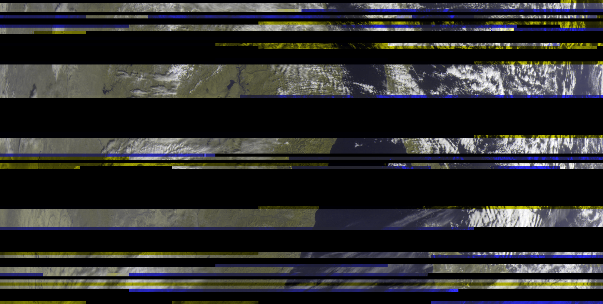
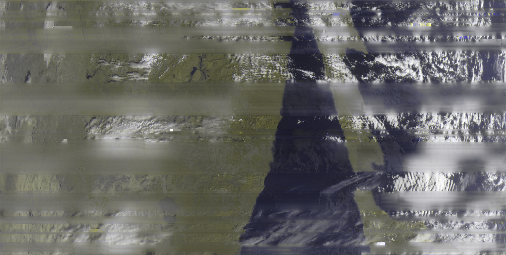
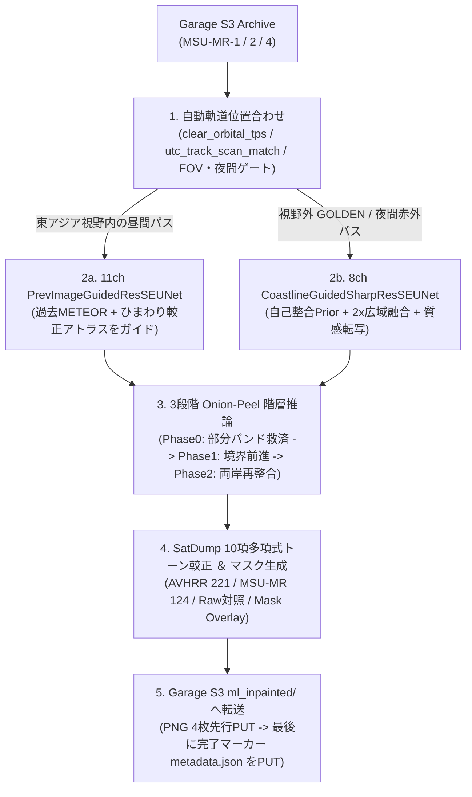

# Radio ML (`radio-astronomy` 連携 METEOR-M2 画像補完 & Garage S3 パイプライン)

ステータス: **Cloud / Mac MPS 補完パイプライン実装・稼働済み**

ベランダ電波観測所リポジトリ（[`tozastation/radio-astronomy`](https://github.com/tozastation/radio-astronomy)）で受信・Garage S3 (`results/`) へアーカイブされた **METEOR-M2 気象衛星 LRPT (MSU-MR) 画像** に対して、Mac (Apple Silicon MPS) 上で欠損補完モデルを実行し、補完済み画像を Garage S3 へ転送して `satellite-viewer` 上に表示するための ML パイプラインです。

## 補完例（`METEOR-M2 3_20261026_003009`）

| 補完前（Raw AVHRR 221） | 補完後（11ch `PrevImageGuidedResSEUNet`） |
| :---: | :---: |
|  |  |

---

## 欠損補完の仕組み（アーキテクチャ ＆ 推論パイプライン）

### 問題設定：なぜ「水平な黒帯」が発生し、単純な画像補間では直らないのか

気象衛星 METEOR-M2 の LRPT ダウンリンクでは、3 つの波長帯が独立したパケット（APID）として送信されます。

- **Ch1 (`MSU-MR-1`)**: 可視光（`0.64 μm`）— 雲・雪・地表の反射
- **Ch2 (`MSU-MR-2`)**: 近赤外（`0.86 μm`）— 植生と水域の強いコントラスト（陸海の判別）
- **Ch4 (`MSU-MR-4`)**: 熱赤外（`10.8 μm`）— 雲頂温度・海面温度（夜間も観測可能）

ベランダ地上局では建物やフェージングによる一瞬の同期外れでパケットが落ちるため、以下の 2 種類の欠損が混在します。

1. **部分欠損（バンド間ズレ）**: 「Ch1 は落ちたが、同じ座標の Ch2 や Ch4 は受信できている」領域（`AVHRR 221` 合成では青や黄の横筋に見える）。
2. **全バンド同時欠損（黒帯ギャップ）**: 同期が数秒〜十数秒途絶えて全チャネルが同時に欠落する、高さ `40〜128 px` におよぶ水平黒帯。

通常のバイリニア補間や単純な L1 損失の U-Net だけでは、条件付き期待値の性質からギャップ内部が平均的な灰色へ平滑化され、間宮海峡や樺太などの海岸線・細かな雲の質感が失われてしまいます。

### 推論パイプライン全体フロー

[run_inpaint_pipeline.py](scripts/run_inpaint_pipeline.py) と [inpainting.py](src/inpainting.py) は、以下の 5 ステップで任意パスの画像補完と Garage S3 転送を自動化しています。



### 2 つのモデルと自動ルーティング

入力パスの軌道位置・観測時間帯に応じて、2 種類のモデルを自動選択（`--mode auto`）します。

| 項目 | 主力：`PrevImageGuidedResSEUNet` (11ch) | フォールバック：`CoastlineGuidedSharpResSEUNet` (8ch) |
| :--- | :--- | :--- |
| **適用対象** | 東アジア視野内の昼間パス（通常・低受信率・単一バンド欠落） | 東アジア視野外（`GOLDEN`）・夜間赤外主体パス（`18:17 UTC` 等） |
| **入力チャネル** | **11ch**: `[観測3, マスク3, 前イメージ3, 陸地確率1, 沿岸エッジ1]` | **8ch**: `[観測3, マスク3, 陸地確率1, 沿岸エッジ1]` |
| **パラメータ数 / 重み** | 約 `1.61M` / `nb11_temporal_prev_bundle.pt` (`6.2 MB`) | 約 `1.60M` / `nb09_coastline_patchgan_bundle.pt` (`13 MB`) |
| **コア構造** | `FastResSEBlock` + `PyramidContextBottleneck` + `PriorGateFusion` + **Temporal Trust Gate** | `FastResSEBlock` + `PyramidContextBottleneck` + `PriorGateFusion` + PatchGAN 敵対的学習 |
| **後処理** | デストリーク（水平筋除去） | 2×広域融合 + デストリーク + 沿岸引き締め + Contextual 質感転写 |

どちらのネットワークも、ボトルネックにマルチスケール文脈集約（`1×1`, `3×3`, `4×4 Pool`, `Global Pool`）を、デコーダ出力直前に地理 Prior を再注入する `PriorGateFusion` を備えており、深い U-Net 層を通過して 1px 単位の海岸線輪郭がボケるのを防いでいます。

さらに 11ch モデルでは、出力層で再構成画像 $I_{\text{net}}$ と空間信頼ゲート $\alpha_{\text{prev}} \in [0, 1]$ を同時予測し、欠損部のみを以下のようにブレンドします。

$$\hat{I} = I_{\text{obs}} \odot M + \Big[(1 - \alpha_{\text{prev}}) \odot I_{\text{net}} + \alpha_{\text{prev}} \odot I^{\text{prev}}\Big] \odot (1 - M)$$

これにより、**実測画素 ($M=1$) は 100% そのまま保持**しつつ、上下の走査線に厚い雲がある箇所では $\alpha_{\text{prev}} \to 0$ で当日の雲同士を繋ぎ、幅 `40〜128 px` の大欠損や低受信率パスでは $\alpha_{\text{prev}} \to 1$ に開いて前イメージの地形・海岸線ディテールを活かします。

### 外部 GIS なしの「前イメージアトラス」と自動軌道位置合わせ

外部の地図タイルサーバー等に依存せず、すべてローカルのアトラスだけで位置合わせまで完結させています。

1. **クラウド除去・放射量較正ベースアトラス (`east_asia_cal_base_atlas.npz`)**:
   - ひまわり 8 号の 5 シーン（`1301×1351`）から雲スコア最小ピクセルを選んで雲除去ベースを作成し、`METEOR-M2` の晴天陸・海輝度統計へ線形較正します。
2. **Leave-One-Out 過去パス逆投影**:
   - 他日に受信・高精度登録された `METEOR-M2` パス（`H >= 120` かつ晴天一致率 `>= 85%`）の晴天画素をアトラス空間へ逆投影ブレンドします。推論時は**対象パス自身を必ず除外（Leave-One-Out）**してリークを防ぎます。
3. **2 段階全自動位置合わせ (`register_pass_to_east_asia`)**:
   - **十分な晴天海岸がある場合 (`clear >= 2000 px`)**: 軌道アフィン＋非線形歪み $u^3$ の Powell 最適化（Stage 1）と沿岸タイルの局所残差 TPS 補間（Stage 2：`clear_orbital_tps`）。一致率が低い場合は `outside_fov` として 8ch モデルへ切り替えます。
   - **極限欠損・単一バンド欠落パス（例：`1122_000222` 生存 11.4%）**: 太陽同期極軌道の UTC 受信時刻から通過経度トラックを絞り込み、生存画素と較正アトラスの L1 相関で位置を特定します（`utc_track_scan_match`）。夜間・赤外主体の場合は昼間アトラスの誤混入を防ぐため `internal_night_or_sparse` として 8ch へ逃がします。

### なぜ 1 発で埋めず「3 段階 Onion-Peel」推論するのか

`64×64` パッチ単位の U-Net で高さ `96 px` の全欠損を一気に埋めようとすると、ギャップ中央のパッチの視野内に実測画素が 1 つも入らなくなります。そのため推論は 3 段階に分割しています。

1. **Phase 0（部分バンド救済）**: どれか 1〜2 チャンネルでも生きている行を先に補完し、実効生存率を引き上げます（`20261026_003009` では `28.6% → 51.3%`）。
2. **Phase 1（段階的 Onion-Peel）**: 欠損マスクの外縁から `11〜12 px` ずつ境界を内側へ前進させ、各ステップで常に実測または既復元エッジを視野に入れながらギャップを閉じ切ります。
3. **Phase 2（両岸共同リファイン ＋ デストリーク）**: ギャップ中央部（端からの距離 `> 20〜24 px`）を左右・上下の両岸をアンカーにして再推論し、タイリングや走査線境界の水平筋を除去します。

### 運用・データ工学上の設計ポイント

- **SatDump 10 項多項式トーン較正**: モデルは生の `Ch1/Ch2/Ch4` 物理空間で推論し、出力時に最小二乗フィットした 10 次元特徴（$1, c_i, \sqrt{c_i}, c_i^2$）で `AVHRR_221`（再現 PSNR `53.47 dB`）および `MSU-MR_124`（同 `29.81 dB`）へ写像するため、既存の SatDump 生成画像と色味が一致します。
- **科学的誠実性（推定領域の明示）**: 大欠損ギャップ中心部に現れる地形は前イメージ由来の推定値であり、その空白上で当日発生していた雲の動きまでは原理的に復元できません。そのため実測・部分救済（`#D4A039`）・全欠損 AI 補完（`#E07A38`）を可視化する `inpaint_mask_overlay.png` と、トリアージ結果（`Tier A / B / C`）を含む `metadata.json` を必ず生成し、`satellite-viewer` 上で区別できるようにしています。
- **条件ハッシュによるキャッシュと冪等転送**: [model_cache.py](src/model_cache.py) の SHA-256 `config_hash` を S3 上の `metadata.json` にも保存し、同一モデル・品質のパスは再推論をスキップします。アップロード時は PNG 4 枚を先に `PUT` し、最後に `metadata.json` を `PUT` することで途中中断時の不完全完了を防止しています。

---

## モデル開発の変遷（Notebook `01` → `11` の試行錯誤）

単発のモデルを最初から組んだわけではなく、実験ノートブック上で**課題発見 → 仮説検証 → 定量ベンチマーク（共通 Hold-out 48 枚 Val および `20261026_003009` フルパス）**を 11 段階回して段階的に精度と汎用性を引き上げました。

### Stage 1（`01`〜`03`）: データ理解と転移学習ベースライン

- **`01` スペクトログラム同期**: Garage S3 から取得した観測データで、スペクトログラム上の信号途切れと画像黒帯の一致を確認。
- **`02` 単一画像自己教師あり U-Net（Val PSNR `18.71 dB`）**: 合成後の RGB 画像 1 枚に対して疑似黒帯マスクを被せて学習する軽量 U-Net（MiniUNet）から開始。
- **`03` ひまわり 8 号事前学習（Val PSNR `19.37 dB`）**: 同じ極東域を撮るひまわり 8 号 4 季節データで事前学習してから METEOR 実測データでファインチューニング。しかし「RGB 合成後の単一画像」という入力表現自体に限界があることが分かりました。

### Stage 2（`04`〜`06`）: マルチバンド化と Apple Silicon MPS 最適化

- **`04` 6ch マルチバンド化（Val PSNR `19.37 → 28.17 dB` / `+8.8 dB`）**: APID ごとに独立欠損する特性を活かし、単一 RGB ではなく `[Ch1, Ch2, Ch4] + [Mask1, Mask2, Mask4]` の 6ch 入力へ転換したことで最大の性能飛躍を達成。
- **`05` MPS ボトルネック解消（`28.03 dB`）**: CPU `DataLoader` と小バッチによる GPU 遊休を解消するため、M2 Unified Memory 上の VRAM に全パッチを一括常駐させ、GPU ベクトル化マスク生成・大バッチ（`B=64`）・`FastHeavyResSEUNet`（`1.11M`）・4-way Flip TTA を導入。
- **`06` 大陸コントラスト損失 ＋ Onion-Peel（Val PSNR `28.72 dB`）**: `Ch2 - Ch1`（植生・陸海）と `Ch2 - Ch4` の色差保存損失と段階的 Onion-Peel、SatDump トーン較正を導入し、部分欠損での色味と連続性を確立。

### Stage 3（`07`〜`09`）: 幅 90 px 全欠損ギャップの攻略（策A / 策B / 策C）

幅 `88〜96 px` の全チャネル同時欠損帯内部でのボケを解消するため、3 つの施策を順次投入しました。

- **`07` 策A（広域ピラミッド ＋ Sobel/FFT 損失）**: ボトルネックに `PyramidContextBottleneck` を追加し、`64×64` 原寸＋`128×128` 広域の 2 尺度学習と Sobel・2D-FFT 複合損失を導入。`20261026` の南北海岸線勾配保持率を `6.8% → 10.7%` へ改善した一方、観測画像のみから 90 km ギャップ内の 1px 海岸線座標を当てる情報量限界が見えました。
- **`08` 策B（ひまわり海岸線マスク ＋ TPS 位置合わせ = `8ch`）**: ひまわり 8 号から抽出した雲除去陸海マスクを 68 手動制御点の Thin-Plate Spline で位置合わせして `8ch` 化し、デコーダ最終段 `PriorGateFusion`（`1.60M`）を導入。沿岸帯勾配保持率が **`6.4% → 54.7%`** へ跳ね上がりました。
- **`09` 策C（PatchGAN ＋ 全自動軌道登録 ＋ 実測 5 倍拡張）**: `08` で残った 3 課題（L1 平均ボケ・手動制御点・データ不足）を同時に解消。未活用だった `GOLDEN_1791698496`（`1456×1568`）投入で実測パッチを約 5 倍（`~4,000+` 枚）へ増強（欠落 `Ch4` は多項式回帰近似＋損失重み `0.25` でバイアス防止）、2 段階全自動軌道・残差 TPS 登録（晴天一致率 `93〜95%` 台＋FOV ゲート）、さらに PyTorch MPS で `aten::vdot` 未実装を回避する自作 `MPSSpectralConv2d` による PatchGAN＋3 層 Feature Matching＋Contextual 高周波質感転写を実装し、沿岸勾配保持 **`83.2%`**・標準 Val **`28.39 dB`** を達成しました（`nb09_coastline_patchgan_bundle.pt`）。

### Stage 4（`10`〜`11`）: 全実測パス横断適用と極限低受信率（生存 11%）救済

- **`10` 全 9 パス横断評価と Tier 分類**: `GOLDEN` 全域、短尺スワス（`H=16〜40 px`）、バンド丸ごと欠落（`1031` Ch2 欠落、`1121` Ch1 欠落）へ単一モデルを適用し、短尺パディングと自動中立 Prior、Tier A/B/C トリアージ基準を確立。一方、受信率 `11.4%` の極限不良パス（`20261122_000222`）では単体画像外挿が灰色帯に留まる限界が判明。
- **`11` 前イメージ時系列ガイド（11ch `PrevImageGuidedResSEUNet`）**: 2 値マスクだけでなく「較正済み 3 波長雲除去地表アトラス＋Leave-One-Out 過去 METEOR 観測」をガイド入力（11ch）に加え、バッチの `35%` で `75〜96%` 極限欠損を模擬学習。`1026_003009` の走査線を意図的に間引いた制御劣化テストでは、`75%` 欠損で **`+0.63 dB`**、`89%` 欠損で **`+0.59 dB`**、極限 40px 全欠損 Val で Sobel 勾配保持 **`24.4% → 34.8%`** を達成し、`1122_000222` でも日本列島・北海道・樺太・沿海州の地形と当日の生存雲を自然に融合できるようになりました（`nb11_temporal_prev_bundle.pt`）。

### Notebook `01`〜`11` 開発履歴一覧

| No. | Notebook | 課題・目的 | 主な導入技術 | 代表指標（Val / 実測） |
| :--- | :--- | :--- | :--- | :--- |
| `01` | [01_meteor_spectrogram_image_sync.ipynb](notebooks/01_meteor_spectrogram_image_sync.ipynb) | 電波状態と画像欠損の関係把握 | スペクトログラム同期・復調可否 CNN | 信号断＝水平黒帯の実証 |
| `02` | [02_meteor_inpainting_mps.ipynb](notebooks/02_meteor_inpainting_mps.ipynb) | 自己教師あり単一画像補完 | MiniUNet + 疑似黒帯マスク | Val `18.71 dB` |
| `03` | [03_himawari_pretrain_meteor_inpainting.ipynb](notebooks/03_himawari_pretrain_meteor_inpainting.ipynb) | 教師データ不足の解消 | ひまわり 8 号事前学習 → FT | Val `19.37 dB` |
| `04` | [04_multiband_msu_mr_inpainting.ipynb](notebooks/04_multiband_msu_mr_inpainting.ipynb) | APID 独立欠損の相互救済 | 6ch マルチバンド U-Net | Val `28.17 dB` (`+8.8 dB`) |
| `05` | [05_heavy_mps_multiband_resunet.ipynb](notebooks/05_heavy_mps_multiband_resunet.ipynb) | Apple M2 MPS 学習高速化 | VRAM 全常駐・ResSE-UNet (`1.11M`)・4-way TTA | Val `28.03 dB` |
| `06` | [06_continent_emergence_progressive_inpainting.ipynb](notebooks/06_continent_emergence_progressive_inpainting.ipynb) | 欠損帯の灰色平均ボケ解消 | 大陸色差損失・Onion-Peel・SatDump 較正 | Val `28.72 dB` |
| `07` | [07_coarse_to_fine_edge_fft_inpainting.ipynb](notebooks/07_coarse_to_fine_edge_fft_inpainting.ipynb) | 策A：大欠損内の構造・鋭さ向上 | ピラミッドネック・2×広域融合・Sobel/FFT 損失 | Val `28.27 dB` / 南北勾配 `10.7%` |
| `08` | [08_coastline_prior_guided_inpainting.ipynb](notebooks/08_coastline_prior_guided_inpainting.ipynb) | 策B：90px 空白内の 1px 海岸線復元 | 8ch 入力・`PriorGateFusion`・TPS 位置合わせ | Val `28.13 dB` / 沿岸帯勾配 `54.7%` |
| `09` | [09_patchgan_auto_prior_expanded_inpainting.ipynb](notebooks/09_patchgan_auto_prior_expanded_inpainting.ipynb) | 策C：微細質感と全自動位置合わせ | `MPSSpectralConv2d` PatchGAN・自動 TPS・5 倍データ | Val `28.39 dB` / 沿岸勾配 `83.2%` |
| `10` | [10_all_recorded_passes_evaluation.ipynb](notebooks/10_all_recorded_passes_evaluation.ipynb) | 全蓄積パス適用と運用基準策定 | 短尺パディング・欠落バンド合成・Tier A/B/C | Probe `26.2〜33.8 dB` (8 パス) |
| `11` | [11_temporal_prev_image_multipass_inpainting.ipynb](notebooks/11_temporal_prev_image_multipass_inpainting.ipynb) | 極限低受信率（`11%` 生存）の救済 | 11ch `PrevImageGuidedResSEUNet`・時系列アトラス | 75%/89% 劣化 `+0.63/+0.59 dB` |

---

## 構成ファイル

- [`src/inpainting.py`](src/inpainting.py) — Notebook `09`/`10`/`11` で検証済みの 8ch Single-Pass (`CoastlineGuidedSharpResSEUNet`)・11ch Temporal Prev-Guided (`PrevImageGuidedResSEUNet`) モデル、自動軌道位置合わせ、ひまわり較正地表アトラス＋Leave-One-Out 過去パス逆投影、SatDump トーン較正、マスクオーバーレイ生成
- [`src/s3_loader.py`](src/s3_loader.py) — Garage S3 (SigV4 `GET` / `HEAD` / `PUT`) クライアントおよびローカルキャッシュ同期ユーティリティ
- [`src/model_cache.py`](src/model_cache.py) — `config_hash` 付きモデルキャッシュユーティリティ
- [`scripts/run_inpaint_pipeline.py`](scripts/run_inpaint_pipeline.py) — Mac から手動実行する補完推論＆Garage S3 転送 CLI
- [`tests/test_inpaint_pipeline.py`](tests/test_inpaint_pipeline.py) — SigV4 PUT/HEAD・モデルロード/推論・差分判定の単体テスト
- `models/` — 学習済みチェックポイント（`nb09_coastline_patchgan_bundle.pt`, `nb11_temporal_prev_bundle.pt`）
- `notebooks/` — 実験・モデル構築ノートブック `01`〜`11`

## 使い方（Mac からの手動実行）

事前に GPD Pocket3 へ SSH 接続できる環境（または環境変数 `GARAGE_ACCESS_KEY` / `GARAGE_SECRET_KEY` 設定済み）で実行します。

### 0. 学習済みモデル（`.pt`）の取得

学習済み重みファイル（`nb09_coastline_patchgan_bundle.pt`, `nb11_temporal_prev_bundle.pt`）は Git リポジトリ本体には含めず、GitHub Release `radio-ml-models-v1` で配布しています。ローカルに無い場合は以下で取得してください（`east_asia_cal_base_atlas.npz` は初回推論時に `data/himawari_multiband_cache.npz` から自動生成・キャッシュされます）。

```bash
gh release download radio-ml-models-v1 --repo tozastation/ml-astronomy -D projects/radio-ml/models
```

### 1. 補完対象パスと S3 ステータスの確認

```bash
uv run python projects/radio-ml/scripts/run_inpaint_pipeline.py --list
```

### 2. ローカル検証のみ（Garage S3 へは書き込まない）

```bash
uv run python projects/radio-ml/scripts/run_inpaint_pipeline.py --pass-id "METEOR-M2 3_20261122_000222" --dry-run
```

### 3. 全未補完パスの推論 ＆ Garage S3 への一括転送

```bash
uv run python projects/radio-ml/scripts/run_inpaint_pipeline.py
```

### 主なオプション

- `--pass-id <ID>`: 特定のパスのみ補完（複数指定可）
- `--latest <N>`: 最新の復号済みパス N 件のみ処理
- `--mode {auto,temporal,single}`: 東アジア視野内昼間パスは 11ch 前イメージガイド (`temporal`)、視野外・夜間赤外専用パスは 8ch 単体 (`single`) を `auto` で自動切替
- `--quality {standard,high}`: `high` で 4-way TTA と細粒度ストライドを有効化
- `--force`: 既に同一 `config_hash` で補完済みでも再計算・再アップロード

## Garage S3 データ契約（`ml_inpainted/`）

元の復号画像（`MSU-MR-*.png` 等）を一切変更せず、各パスの S3 ディレクトリ配下に `ml_inpainted/` サブディレクトリを追加します。

- `results/<satellite>/<pass_id>/ml_inpainted/avhrr_221_inpainted.png`: AI 補完済み AVHRR 221 False Color
- `results/<satellite>/<pass_id>/ml_inpainted/msu_mr_124_inpainted.png`: AI 補完済み MSU-MR 124 False Color
- `results/<satellite>/<pass_id>/ml_inpainted/raw_avhrr_221_aligned.png`: Before/After 比較スライダー用の補完前 Raw AVHRR 221
- `results/<satellite>/<pass_id>/ml_inpainted/inpaint_mask_overlay.png`: 実測・部分救済(`#D4A039`)・AI補完(`#E07A38`) 境界オーバーレイ
- `results/<satellite>/<pass_id>/ml_inpainted/metadata.json`: 使用モデル・ハッシュ・位置合わせ精度・品質 Tier（PNG 4 枚アップロード完了後に最後に書き込まれる完了マーカー）

## テスト

```bash
uv run --with pytest python -m pytest projects/radio-ml/tests/test_inpaint_pipeline.py -v
```
